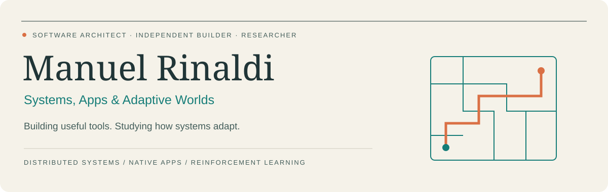
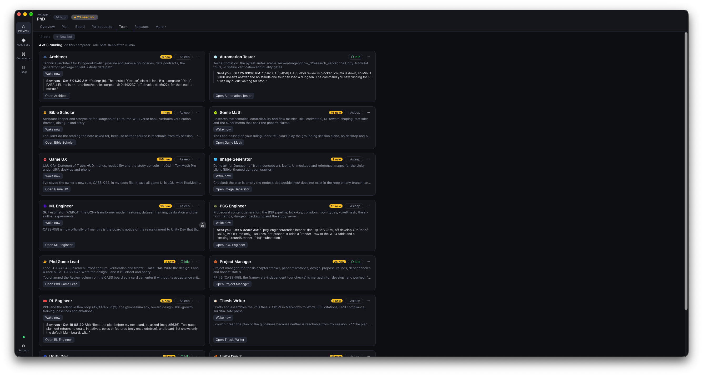
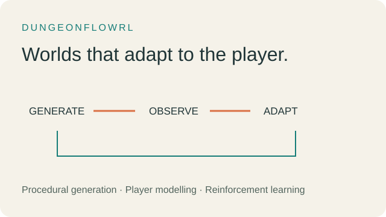
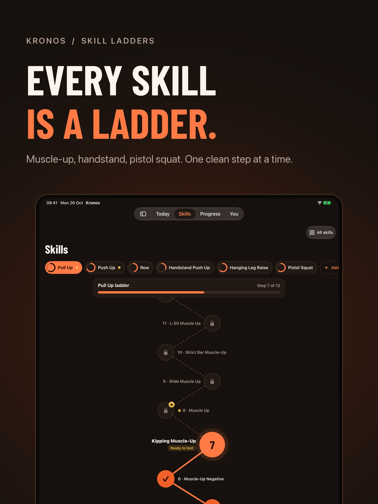
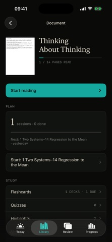

  
  
  
  

### Hi, I'm Manuel

I'm a **software architect, independent app developer and PhD researcher**. I build distributed systems, tools for working with AI agents, and native apps for learning, training and everyday life. My research explores how games can adapt to the people playing them.

- **Engineering:** distributed and event-driven systems, payments platforms, Java backends and cloud infrastructure.
- **Independent work:** Flotilla, an always-on workspace for AI coding agents, alongside iPhone, iPad and Apple Watch apps.
- **Research:** PhD studies at POLITEHNICA Bucharest, working on procedural generation, player modelling and reinforcement learning.

### Selected things I've built

<table>
<tr>
<td width="50%" valign="top">

<h3>Flotilla</h3>

An always-on desktop workspace for teams of AI coding agents. A Rust daemon coordinates persistent agents, durable messaging and scheduling, with a desktop client and an iPhone companion.

<strong>Open source · Rust · Tauri · React</strong>

<a href="https://github.com/mrinaldi2/flotilla">Source &amp; installation →</a> · <a href="https://github.com/mrinaldi2/flotilla-ios">iPhone companion</a>

</td>
<td width="50%" valign="top">

<h3>DungeonFlowRL · Dungeon of Truth</h3>

A research framework and playable Unity testbed connecting procedural dungeon generation, player modelling and reinforcement learning to study adaptive gameplay.

<strong>PhD research · Python · PyTorch · Unity</strong>

<a href="https://manuelrinaldi.com/research">Research &amp; publications →</a>

</td>
</tr>
<tr>
<td width="50%" valign="top">

<h3>Kronos: Calisthenics</h3>

Train towards skills, one progression at a time. Build sessions around your current level and advance by meeting clear standards.

<strong>Native iOS · Apple Watch · Skill progression</strong>

<a href="https://apps.apple.com/us/app/kronos-calisthenics/id6757181327">View on the App Store →</a>

</td>
<td width="50%" valign="top">

<h3>Solon: Master what you read</h3>

Turn a PDF into a study plan with reading sessions, active recall and spaced repetition. Review what you remember and adjust the plan as you learn.

<strong>Native iOS &amp; iPadOS · Learning tools</strong>

<a href="https://apps.apple.com/us/app/solon-master-what-you-read/id6805920857">View on the App Store →</a>

</td>
</tr>
</table>

### More apps & code

| Project | What you'll find | Explore |
| --- | --- | --- |
| **Plod: Calm Run Coach** | Voice-guided runs, personal training paces and on-device tracking. | [App Store](https://apps.apple.com/us/app/plod-calm-run-coach/id6801514966) |
| **Rosario 54** | A guided 54-day Rosary novena, one prayer at a time. | [App Store](https://apps.apple.com/us/app/rosario-54/id6801182922) |
| **Mercy Chaplet** | A guided Divine Mercy Chaplet. | [App Store](https://apps.apple.com/us/app/mercy-chaplet/id6803369126) |
| **Medjugorje: Peace Chaplet** | A simple prayer companion with tap, voice and hands-free modes. | [App Store](https://apps.apple.com/us/app/medjugorje-peace-chaplet/id6804197688) |
| **Computer Vision with PyTorch** | Flower classification using transfer learning. | [Source code](https://github.com/mrinaldi2/computer_vision_pytorch) |

### Technologies I work with

**Machine learning & research**  

**Backend & infrastructure**  

**Apps & interactive experiences**  

### Research & writing

- [Two-Scale Controllability of a Parameterised BSP Dungeon Generator for Player Flow Optimisation](https://ieeexplore.ieee.org/document/11558483) — *IEEE Transactions on Games*, 2026, with Costin-Gabriel Chiru.
- [Semantic Vision Priors for Multi-Agent Reinforcement Learning: Improving Unity Tank Battles with Frozen Vision-Language Models](https://ieeexplore.ieee.org/document/11208427/) — *RoEduNet*, 2025, with Costin-Gabriel Chiru.
- [Thinking in Tensors](https://www.amazon.com/dp/B0HJ8QFBKZ) — *Deep Learning Building Blocks, Volume 1*: shapes, axes, operations and the language of deep learning.
- [More books](https://amazon.com/author/manuelrinaldi) · [Research & background](https://manuelrinaldi.com/research)

<strong>Education & background</strong>

- PhD studies in Computer Science, POLITEHNICA Bucharest, since 2024.
- Master's in Data Science & Artificial Intelligence, Titu Maiorescu University.
- Bachelor's in Computer Engineering, Titu Maiorescu University.
- Software architecture across payments and gaming, including Endava and Playtika.
- Kubernetes for Developers · Robot Software Engineer Nanodegree · AI Programming with Python Nanodegree.

---

**Let's connect:** [Portfolio](https://manuelrinaldi.com) · [LinkedIn](https://linkedin.com/in/manuelrinaldi) · [App Store](https://apps.apple.com/us/developer/manuel-rinaldi/id395552298)
